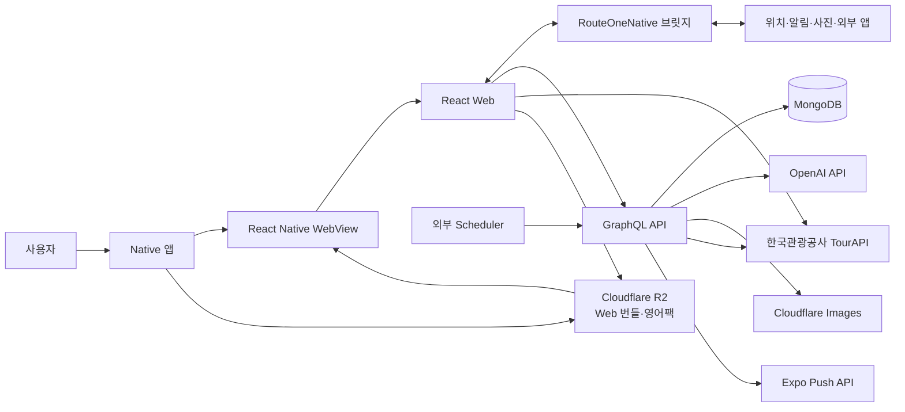
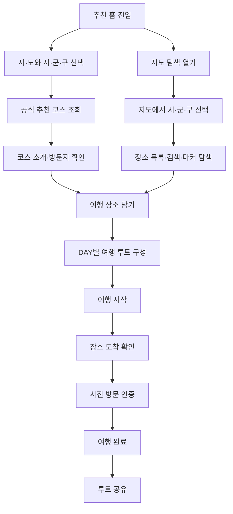

# 마실 (Masil)


**오늘은 어디로 마실 갈까요?**

마실은 한국관광공사 공식 여행 코스와 지역별 지도를 바탕으로 여행을 계획하고, 실제 방문과 기록·공유까지 이어가는 하이브리드 여행 앱입니다. 추천 코스의 방문지를 한 번에 담거나 지도에서 시·군·구를 눌러 장소를 직접 고른 뒤 날짜별 루트를 만들 수 있습니다.

React 화면을 React Native WebView에서 실행하고 기기 권한·알림·사진·외부 앱 연동은 Native가 담당합니다. 서비스 이름은 RouteOne에서 마실로 변경했으며 저장소 이름과 기존 앱 식별자, `RouteOneNative` 브릿지 이름은 유지합니다.

## 프로젝트 배경

이 프로젝트는 RouteOne이라는 이름으로 공모전에 참여하면서 시작했습니다. 개발 경험을 넓히고 커리어에 활용할 프로젝트를 만들고 싶었고, 공모전의 필수 조건이었던 한국관광공사 API를 활용해 어떤 서비스를 만들지 고민했습니다. 어릴 때부터 자주 여행해 익숙했던 강원도를 초기 주요 지역으로 선택했습니다.

강원도는 바다와 먹거리, 관광 명소가 다양하지만 지역에 익숙하지 않은 사람에게는 잘 알려진 장소 외의 여행지를 찾고 동선을 구성하는 일이 쉽지 않을 수 있습니다. 또한 한국을 찾는 외국인 관광객이 늘어나는 상황에서 서울뿐 아니라 강원도라는 지역도 부담 없이 탐방할 수 있게 만들고 싶었습니다.

그래서 관광 정보를 나열하는 데 그치지 않고, 지역별 장소 탐색부터 날짜별 여행 루트 구성, 실제 방문 기록과 다른 사용자의 루트 공유까지 하나의 흐름으로 이어지는 서비스를 기획했습니다.

이후 서울·경기도 등 여러 시·도로 탐색 범위를 넓히고 공식 추천 코스에서 여행을 시작하는 홈을 추가했습니다. 앱 이름과 아이콘, 시작 화면도 마실로 통일했습니다.

### 하이브리드 구조를 선택한 이유

지도 탐색, 검색, 여행 일정과 공유 화면은 Web에서 관리하고, 위치 권한, 푸시 알림, 카메라·앨범, 이미지 저장·공유와 외부 지도 앱 실행은 Native에서 처리합니다. 화면과 서비스 흐름을 Web에서 한 번 구현하면서도 모바일 기기 기능이 필요한 지점은 WebView 브릿지로 연결하기 위해 이 구조를 사용합니다.

## 핵심 기능

| 기능 | 설명 |
| --- | --- |
| 공식 추천 코스 | 시·도 전체 또는 여러 시·군·구의 한국관광공사 코스를 조회하고, 코스 소개·방문 순서·거리·시간·테마를 확인해 일정 만들기로 연결합니다. |
| 지도·장소 목록 탐색 | 지도에서 시·군·구를 누르면 해당 지역의 장소 목록을 열고, 마커나 목록에서 상세 확인과 장소 담기를 이어갑니다. 검색·카테고리 조건도 함께 적용합니다. |
| 여행 루트 구성 | 추천 코스 또는 직접 담은 장소로 DAY별 일정을 만듭니다. 여행 템포·체류·이동 시간을 바탕으로 1~3일을 추천하고 출발지와 방문 순서를 조정합니다. |
| 자동차·도보 길찾기 | 현재 위치나 지도에서 고른 출발지로 경로를 확인하고 네이버 지도로 연결합니다. 자체 도보 경로 계산은 강릉 일부 지역의 보행로 데이터를 사용합니다. |
| 여행 진행과 방문 기록 | 여행 시작 상태, 장소별 방문 여부와 실제 체류 시간을 기록하고 사진으로 방문을 인증합니다. |
| 도착·축제·루트 알림 | 여행 장소 도착과 여행 완료 후 회고를 안내합니다. 축제 알림은 여러 시·도에서 시·군·구를 최대 두 곳까지 선택합니다. |
| 공유 루트 | 완료한 여행 루트를 공개하고 시·도·장소 조건으로 탐색합니다. 좋아요 목록은 전체·지역별로 보고, 다른 사용자의 루트를 내 일정으로 복제합니다. |
| 한국어·영어 전환 | 홈에서 로그인 없이 언어를 바꿉니다. 영어 UI 팩은 처음 필요할 때 R2에서 받아 저장하고, 추천 코스·장소 정보는 별도 번역과 캐시를 사용합니다. |
| 신고와 운영 관리 | 방문 사진과 공유 루트를 신고하고 권한이 있는 계정에서 숨김·검토 상태를 관리합니다. |
| Web 번들 업데이트 | R2 채널에 배포된 새 Web 번들을 Native 앱에서 검증해 설치하고, 실행에 실패하면 이전 번들이나 내장 번들로 복구합니다. |

## 서비스 구성



Web은 Native WebView 안에서 추천 코스, 지도 탐색, 여행 일정, 공유 루트와 설정 화면을 담당합니다. 네트워크 프록시와 위치·알림·사진 기능은 `window.RouteOneNative` 브릿지를 통해 Native에 요청합니다. 일반 브라우저 실행은 로컬 개발과 화면 확인에 사용합니다.

API는 사용자, 여행 루트, 방문 기록, 공식 추천 코스 목록, 장소 현지화, 알림과 신고 데이터를 GraphQL로 제공합니다. 공식 코스 목록은 서버에서 지역별로 분류하고, 코스의 상세 소개와 방문지 정보는 Web에서 TourAPI로 조회합니다. 방문 사진은 Cloudflare Images 직접 업로드 URL을 발급해 저장하고, API에는 사진 참조와 공개 동의 상태를 기록합니다.

## 저장소 구조와 앱별 역할

```text
.
├── apps
│   ├── api              # GraphQL API, 인증, 여행 루트, 알림, 현지화와 운영 기능
│   ├── image-analyzer   # 방문 사진 OCR·장면 분석 서비스
│   ├── native           # WebView 컨테이너와 모바일 기기 기능
│   └── web              # 지도 탐색, 여행 일정, 공유와 설정 화면
├── scripts              # 변경 기반 커밋 전 검사와 R2 배포 스크립트
├── .githooks            # 터미널·Fork에서 실행하는 Git 훅
├── .agents/skills       # 기능별 AI 검증 절차
├── .codex/agents        # AI 리뷰 역할 설정
├── docs/ai              # 화면·도메인별 프로젝트 맥락과 검증 기준
└── .github/workflows    # Web 번들과 Native 업데이트 정책 배포 자동화
```

| 앱 | 역할 |
| --- | --- |
| `apps/web` | 공식 추천 코스, 지도·목록 탐색, 여행 루트 구성·진행, 공유 루트, 언어·지역·계정 설정을 담당합니다. |
| `apps/native` | Web을 WebView로 실행하고 로그인 세션, 위치, 알림, 사진, 외부 앱과 Web 번들 업데이트를 연결합니다. |
| `apps/api` | 공식 코스의 지역별 색인, 사용자 인증, 여행 루트와 방문 기록, 현지화, 알림, 신고와 이미지 참조 데이터를 관리합니다. |
| `apps/image-analyzer` | 방문 사진 OCR·장면 분석을 별도로 실험할 수 있는 보조 서비스입니다. 현재 API source에는 호출 연결이 없습니다. |

## 핵심 사용자 흐름



## 기술 스택과 선택 이유

| 영역 | 사용 기술 | 사용 이유 |
| --- | --- | --- |
| Monorepo | pnpm workspace | Web, Native, API와 분석 서비스를 한 저장소에서 관리하고 앱 간 빌드 흐름을 연결하기 위함 |
| Web | React 19, Vite 8, TypeScript, Tailwind CSS 4 | Native WebView에서 실행할 화면과 사용자 흐름을 웹 개발 방식으로 구현하고 관리하기 위함 |
| 클라이언트 상태 | TanStack Query 5, Zustand 5 | 서버 데이터 캐시와 화면·검색·여행 담기 상태를 분리하기 위함 |
| 지도·관광 데이터 | Naver Maps, 한국관광공사 Tour API | 공모전 필수 조건인 한국관광공사 API의 관광지·음식점·축제 데이터를 지역별 지도 탐색으로 연결하기 위함 |
| Native | Expo 56, React Native, React Native WebView | Web을 앱에 내장하면서 위치·알림·사진과 외부 앱 기능을 제공하기 위함 |
| API | Node.js, Fastify, Apollo Server, GraphQL | 클라이언트가 화면에 필요한 필드만 선택해 조회하도록 GraphQL을 사용하고, Apollo Server와 연동되는 Fastify 서버를 Cloud Run의 무료 사용량 범위에서 운영하기 위함 |
| 데이터 | Prisma, MongoDB | 사용자와 여행 루트 데이터를 관리하면서 MongoDB Atlas 무료 티어로 초기 운영 비용 부담을 줄이기 위함 |
| 이미지 | Cloudflare Images | 방문 인증 사진의 직접 업로드와 공개 URL, 삭제 흐름을 관리하기 위함 |
| 배포·업데이트 | GitHub Actions, Cloudflare R2, Expo EAS | Web 번들과 Native 바이너리 배포 주기를 분리하기 위함 |
| 오류 수집 | Sentry | Web, Native, API의 런타임 오류를 앱별로 구분해 확인하기 위함 |

## 주요 구현과 개선

### 마실 리브랜딩과 진입 화면

서비스 이름을 마실로 바꾸고 열린 문 아이콘을 앱 런처, 시스템 스플래시, WebView 시작 화면, 홈과 로그인 화면에 적용했습니다. 도착 알림과 여행 포토카드에도 같은 이름을 사용합니다. 첫 실행은 언어 선택과 기기 권한 설정을 거쳐 앱으로 진입하며, 기존 앱 식별자와 브릿지는 유지해 업데이트·연동 경로를 이어갑니다.

### 지도에서 지역을 누르고 목록으로 탐색

추천 홈(`/home`)과 지도 탐색(`/home/map`)을 분리했습니다. 지도에는 선택한 시·도의 시·군·구 경계를 표시하고, 누른 좌표가 속한 지역으로 탐색 조건을 바꿉니다. 지역을 바꿔도 권역 경계와 줌을 유지하며 마커를 누르면 기존 장소 상세를 엽니다. 지도 아래 목록은 같은 검색·카테고리 조건을 사용하고, 목록에서 바로 장소를 담을 수 있습니다. 목록 펼침·접기에는 전환 효과를 적용했습니다.

서울·강원 외에도 경기도 등 등록된 시·도로 지역 선택을 확장했습니다. 경기도는 수원을 포함한 31개 시·군을 선택하며 일반구는 관광공사 조회 단위인 상위 시로 연결합니다. 사용자가 둘러보는 탐색 지역과 설정에 저장하는 기본 지역은 별도로 관리합니다.

내 위치 버튼은 지원 지역 안에서 탐색 지역을 자동 전환합니다. 지원 지역 밖에서는 기존 탐색 지역을 유지한 채 현재 좌표로 이동해 파란 점과 안내를 표시합니다. 위치 조회 중 사용자가 지역을 바꾸면 이전 요청이 새 선택을 덮어쓰지 않도록 합니다.

### 공식 추천 코스를 실제 일정으로 연결

홈의 코스 제목과 방문 순서는 한국관광공사가 제공한 공식 여행 코스를 사용합니다. API가 행정 코드·관광공사 지역 코드·대표 좌표와 경계 데이터로 지역별 색인을 만들고, 선택한 시·도 전체 또는 여러 시·군·구의 합집합을 페이지로 조회합니다. 갱신 요청은 하나로 합치고 갱신 실패 시 마지막으로 준비된 색인을 유지합니다. API 단독 빌드에서도 경계를 읽을 수 있도록 데이터 파일을 API 내부에 포함했습니다.

코스 카드에는 전체 소개와 방문 순서, 방문지 이름·주소, 거리·소요시간·테마를 표시합니다. 방문지 상세에서는 해당 코스의 방문지 설명도 확인할 수 있습니다. 거리·시간이 없으면 라벨만 유지하고, 테마가 없거나 기관 분류값이면 숨깁니다.

코스에 방문지 식별자나 지도에 연결할 장소 정보가 하나라도 없으면 코스 전체를 목록에서 제외합니다. 표시할 수 있는 코스가 없는 페이지는 다음 페이지를 확인하고, 유효한 코스는 공식 방문 순서로 한 번에 담되 이미 담은 장소는 중복으로 넣지 않습니다. 추가 조회는 `코스 더 보기` 버튼의 스피너·진행 문구로 표시하고 기존 카드와 스크롤 위치를 유지합니다. 지역 선택 영역이 화면 위로 벗어나면 맨 위 이동 버튼을 보여줍니다.

### 일정·공유 루트·알림의 지역과 상태 연결

일정 만들기는 장소별 예상 체류·이동 시간, 하루 활동 시간과 여행 템포로 1~3일을 추천합니다. 3일 안에 담기 어려운 일정은 일수를 직접 조정하도록 안내하고, 출발지 단계에 다시 들어가도 이전 선택을 유지합니다. 비로그인 상태에서 저장을 눌렀다면 계산한 일정을 보관해 로그인 후 저장을 이어갑니다. 진행 중인 오늘 일정을 펼치면 현재 목적지로 스크롤과 포커스를 이동합니다.

공유 루트는 시·도별 공개 피드와 전체·지역별 좋아요 목록을 제공합니다. 공개 목록과 좋아요 목록의 필터 상태를 분리하고, 공유 루트에서 고른 지역을 홈 추천 코스 조회에도 전달합니다. 좋아요 변경은 현재 목록에 즉시 반영하고 다른 지역 목록의 캐시도 갱신합니다.

축제 알림은 여러 시·도의 시·군·구를 선택할 수 있습니다. 기본 지역을 바꾸면 켜진 축제 알림의 지역을 동기화하고 이전 지역의 미발송 알림을 취소합니다. 지역 교체와 알림 정리를 트랜잭션으로 처리하며, 축제 조회가 실패한 대상은 다음 스케줄 실행에서 다시 확인합니다.

### 언어 확장을 고려한 UI 팩 분리

기존에는 한국어·영어 UI 문구를 `uiText.ts` 한 파일에서 관리하고 모두 기본 Web 번들에 포함했습니다. 문구가 늘면서 파일과 번들 용량이 커지는 문제에 더해, 향후 중국어·일본어 등을 추가하면 사용하지 않는 언어까지 모든 사용자에게 전달하게 됩니다. 언어가 더 늘어나기 전에 문구 파일을 나누고 필요한 언어만 받는 구조로 변경했습니다.

파일을 나누어도 모든 언어를 기본 번들에서 불러오면 전송 용량은 계속 늘어납니다. 한국어는 네트워크 없이도 기본 UI를 제공하도록 번들에 남기고, 영어는 별도 팩으로 빌드해 R2에서 선택한 사용자에게만 전달합니다. 현재는 한국어·영어를 지원하며 추가 언어의 용량이 기본 번들에 함께 쌓이지 않도록 배포 방식을 분리했습니다.

언어 설정은 내 정보에서 홈 오른쪽 위 지구본 버튼으로 옮겨 로그인 없이 사용할 수 있게 했습니다. 처음 영어를 선택하면 팩을 다운로드하고 SHA-256을 검증한 뒤 저장합니다. 같은 버전은 저장본을 재사용하고 새 Web 번들이 다른 해시를 참조하면 새 팩을 준비합니다.

첫 실행의 영어 선택과 앱 안의 언어 전환에 다운로드 진행률을 표시합니다. 앱 안에서는 다운로드 모달이 탭 이동과 내부 뒤로가기를 막고, 실패하면 한국어를 유지해 다시 시도할 수 있게 합니다. 영어 사용자가 재실행할 때는 Web 번들에 맞는 영어팩까지 준비한 뒤 첫 화면을 표시해 한국어 화면이 잠깐 노출되는 현상을 막습니다.

추천 코스 제목·전체 소개·방문지별 설명과 장소 이름·주소는 UI 팩과 별도로 현지화 API와 캐시를 사용합니다. 코스 설명은 일반 장소 설명과 캐시를 구분하고, 번역을 준비하지 못한 경우 원문을 표시합니다.

### 자동차와 도보 길찾기

장소 상세에서 자동차·도보를 전환하고 지도에서 출발지를 직접 고를 수 있습니다. 선택한 이동수단으로 네이버 지도를 열며, 자체 도보 경로는 공개 보행로 데이터의 연결 관계·통행 방향·계단 구간을 반영해 거리와 시간을 계산합니다.

자체 도보 계산 범위는 현재 **강릉 시내·경포·안목**입니다. 보행로 데이터가 없는 지역은 미지원 안내를 표시하며, 지도에서 탐색할 수 있는 지역과 자체 도보 계산 범위는 구분합니다.

## 빠른 시작

```bash
pnpm install
pnpm --filter api prisma:generate
pnpm api:local
pnpm dev:web
```

API는 `apps/api/.env`, Web은 `apps/web/.env`에 필요한 값을 설정합니다.

| 대상 | 기본 주소 |
| --- | --- |
| Web | `http://localhost:5173` |
| GraphQL API | `http://localhost:4000/graphql` |
| API 상태 확인 | `http://localhost:4000/health` |
| Image Analyzer | `http://127.0.0.1:4100` |

## 주요 루트 명령어

| 명령어 | 설명 |
| --- | --- |
| `pnpm dev:web` | Web 개발 서버를 실행합니다. |
| `pnpm api:local` | `apps/api/.env`로 API 서버를 실행합니다. |
| `pnpm api:dev` | API의 `.env.development`를 우선 적용하고 빠진 값은 `.env`에서 채웁니다. 이미 설정된 프로세스 환경변수는 유지합니다. |
| `pnpm dev:api:test` | GPS 방문 인증 우회가 활성화된 API 개발 서버를 실행합니다. |
| `pnpm dev:analyzer` | 로컬 Image Analyzer를 실행합니다. |
| `pnpm build:web` | Web 타입 검사와 프로덕션 빌드를 실행합니다. |
| `pnpm build:api` | API TypeScript 빌드를 실행합니다. |
| `pnpm lint` | Web ESLint 검사를 실행합니다. |
| `pnpm native:ios:local` | Native의 `.env`만 적용하고 영어팩을 내장해 로컬 iOS 시뮬레이터를 실행합니다. 영어팩은 R2에서 받지 않습니다. |
| `pnpm native:ios:dev` | Native의 `.env.development`로 개발용 iOS 프로젝트와 Web 번들을 준비합니다. |
| `pnpm native:ios:prod` | Native의 `.env.production`으로 운영용 iOS 프로젝트와 Web 번들을 준비합니다. |
| `pnpm native:ios:device` | 연결된 iPhone에 로컬 개발 앱을 설치합니다. |
| `pnpm native:sync:web` | Web을 다시 빌드해 Native 내장 번들에 반영합니다. |
| `pnpm native:typecheck` | Native TypeScript 타입 검사를 실행합니다. |

## 배포와 업데이트

Web 번들은 `develop` 브랜치에서 dev 채널, `main` 브랜치에서 prod 채널로 빌드해 Cloudflare R2에 게시합니다. Native는 내장 번들을 기본으로 준비한 뒤 채널 manifest의 버전과 SHA-256을 확인해 새 번들을 설치합니다.

영어팩도 각 채널의 R2에 `language-packs/` 파일로 별도 발행하고 Web 번들 ZIP에서는 제외합니다. 발행 스크립트는 영어팩 누락·해시 불일치를 검사하고, 영어팩과 Web 번들이 준비된 뒤 최신 버전을 갱신합니다. 앱은 적용할 Web 번들과 그 번들이 참조하는 영어팩을 함께 준비해 시작 화면의 진행률에 반영합니다.

Native 최소 버전 정책도 dev/prod 채널로 나누어 R2에 게시합니다. 설치 앱 버전이 정책의 최소 버전보다 낮으면 WebView에 진입하기 전에 스토어 업데이트 화면을 표시합니다. Native 바이너리는 Expo EAS 프로필과 App Store Connect 제출 흐름을 사용합니다.

API와 Image Analyzer의 실제 배포 트리거는 저장소에 완전한 설정이 없으므로 각 배포 환경에서 별도로 확인해야 합니다.

## 개발·검증 자동화

### 변경 범위에 따른 커밋 전 검사

커밋 후 빌드 오류를 확인하고 다시 수정·커밋하는 과정을 줄이기 위해 로컬 Git 훅에서 검사를 실행합니다. 커밋할 때마다 관련 테스트를 직접 고르지 않도록 스테이징한 코드를 임시 폴더에 복원하고, 테스트가 참조하는 소스와 공통 모듈을 따라 실행 대상을 선택합니다. 작업 폴더에만 남아 있는 수정이 검사 결과에 섞이지 않도록 테스트 선택 규칙도 스테이징한 버전을 사용합니다.

| 변경 내용 | 자동 검사 범위 |
| --- | --- |
| Web·API·Native 코드 | 변경 영역의 TypeScript 타입 검사와 소스 참조로 연결된 Node 테스트 |
| Web TS·TSX 파일 | 변경 파일의 ESLint 검사 |
| 새로 추가하거나 수정한 테스트 | 해당 테스트를 실행 목록에 포함 |
| 앱 설정·루트 의존성 | 앱별 설정은 해당 앱 전체, 루트 의존성은 전체 테스트로 확대 |
| API 스키마·Prisma 스키마 | Web·API 테스트 전체로 확대 |
| iOS 도착 알림 모듈 | 기존 Swift 테스트 컴파일·실행 |

새로 클론한 저장소에서는 한 번 연결한 뒤 터미널과 Fork에서 같은 훅을 사용합니다.

```bash
git config --local core.hooksPath .githooks
```

검사가 실패하면 커밋을 차단하고 검사 이름과 원래 오류를 출력합니다. 실행한 테스트별 통과·실패 결과는 터미널 또는 Fork의 Activity Manager에서 확인할 수 있습니다. 선택 규칙과 실제 Git 훅의 차단·통과 동작은 별도 회귀 테스트로 검증합니다.

현재 자동 선택은 소스에 적힌 경로를 기준으로 하므로 동적으로 조합한 경로는 추적하지 못합니다. 연결된 자동 테스트가 없는 파일은 로그에 표시하며, 실제 DB에 쓰는 통합 테스트는 테스트 DB를 지정해 별도로 실행합니다. 저장소에 실행용 Playwright 테스트는 없으므로 화면·시뮬레이터 검증은 별도로 수행합니다. 검사 목록 확인과 전체 검사 명령은 [커밋 전 검사 문서](docs/ai/project-context.md#커밋-전-검사)에 정리했습니다.

### AI 작업 맥락과 리뷰 기준

여러 앱과 기능을 수정할 때 AI가 확인할 진입점과 검증 기준을 찾을 수 있도록 [AGENTS.md](AGENTS.md)와 [프로젝트 맥락](docs/ai/project-context.md)을 연결했습니다. 일정·내 루트·공유 루트는 [일정과 루트 문서](docs/ai/route-flows.md), 내 정보·인증·알림·WebView는 [계정과 앱 공통 기능 문서](docs/ai/account-platform-flows.md)에서 상태·요청·서버 규칙을 확인하도록 구성했습니다.

홈 추천·지도와 나머지 주요 기능의 검증 절차를 [홈 검증 skill](.agents/skills/masil-home-verification/SKILL.md)과 [기능 검증 skill](.agents/skills/masil-feature-verification/SKILL.md)로 나누었습니다. 독립 리뷰가 필요할 때 사용할 [masil-reviewer](.codex/agents/masil-reviewer.toml)에는 권한, 계정 전환, 캐시, API 계약과 네이티브 연동에서 확인할 회귀 조건을 정의했습니다.

## 앱별 상세 문서

| 문서 | 상세 내용 |
| --- | --- |
| [Web README](./apps/web/README.md) | 화면과 라우트, 지도 탐색, 상태 관리, API·Native 브릿지 연결 |
| [Native README](./apps/native/README.md) | WebView 실행, 브릿지, 권한·알림·사진, Web 번들 업데이트와 빌드 |
| [API README](./apps/api/README.md) | GraphQL 도메인, 인증, 알림 스케줄러, 이미지와 현지화 처리 |
| [Image Analyzer 소스](./apps/image-analyzer) | 방문 사진 분석 보조 서비스와 실행 설정 |
