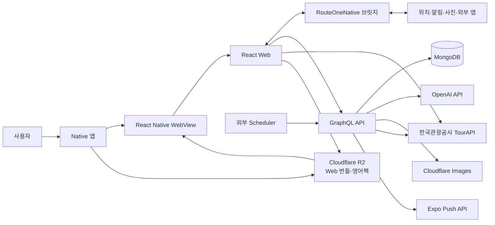
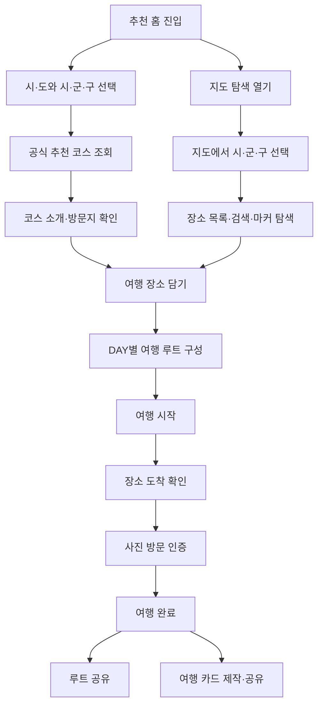

# 마실 (Masil)


**오늘은 어디로 마실 갈까요?**

마실은 한국관광공사 공식 여행 코스와 지역별 지도를 바탕으로 여행을 계획하고, 실제 방문과 기록·공유까지 이어가는 하이브리드 여행 앱입니다. 추천 코스의 방문지를 한 번에 담거나 지도에서 시·군·구를 눌러 장소를 직접 고른 뒤 날짜별 루트를 만들 수 있습니다.

React 화면을 React Native WebView에서 실행하고 기기 권한·알림·사진·외부 앱 연동은 Native가 담당합니다. 서비스 이름은 RouteOne에서 마실로 변경했으며 저장소 이름과 기존 앱 식별자, `RouteOneNative` 브릿지 이름은 유지합니다.

## 프로젝트 배경

이 프로젝트는 RouteOne이라는 이름으로 공모전에 참여하면서 시작했습니다. 개발 경험을 넓히고 커리어에 활용할 프로젝트를 만들고 싶었고, 공모전의 필수 조건이었던 한국관광공사 API를 활용해 어떤 서비스를 만들지 고민했습니다. 어릴 때부터 자주 여행해 익숙했던 강원도를 초기 주요 지역으로 선택했습니다.

강원도는 바다와 먹거리, 관광 명소가 다양하지만 지역에 익숙하지 않은 사람에게는 잘 알려진 장소 외의 여행지를 찾고 동선을 구성하는 일이 쉽지 않을 수 있습니다. 또한 한국을 찾는 외국인 관광객이 늘어나는 상황에서 서울뿐 아니라 강원도라는 지역도 부담 없이 탐방할 수 있게 만들고 싶었습니다.

그래서 관광 정보를 나열하는 데 그치지 않고, 지역별 장소 탐색부터 날짜별 여행 루트 구성, 실제 방문 기록과 다른 사용자의 루트 공유까지 하나의 흐름으로 이어지는 서비스를 기획했습니다.

이후 서울·경기도 등 여러 시·도로 탐색 범위를 넓히고 공식 추천 코스에서 여행을 시작하는 홈을 추가했습니다. 앱 이름과 아이콘, 시작 화면도 마실로 통일했습니다.

### 하이브리드 구조를 선택한 이유

지도 탐색, 검색, 여행 일정과 공유 화면은 Web에서 관리하고, 위치 권한, 푸시 알림, 카메라·앨범, 이미지 저장·공유와 외부 지도 앱 실행은 Native에서 처리합니다. 화면과 서비스 흐름을 Web에서 한 번 구현하면서도 모바일 기기 기능이 필요한 지점은 WebView 브릿지로 연결하기 위해 이 구조를 사용합니다.

## 핵심 기능

| 기능 | 설명 |
| --- | --- |
| 공식 추천 코스 | 시·도 전체 또는 여러 시·군·구의 한국관광공사 코스를 조회하고, 코스 소개·방문 순서·거리·시간·테마를 확인해 일정 만들기로 연결합니다. |
| 지도·장소 목록 탐색 | 지도에서 시·군·구를 누르면 해당 지역의 장소 목록을 열고, 마커나 목록에서 상세 확인과 장소 담기를 이어갑니다. 검색·카테고리 조건도 함께 적용합니다. |
| 여행 루트 구성 | 추천 코스 또는 직접 담은 장소로 DAY별 일정을 만듭니다. 여행 템포·체류·이동 시간을 바탕으로 1~3일을 추천하고 출발지와 방문 순서를 조정합니다. |
| 자동차 길찾기 | 현재 위치나 지도에서 고른 출발지로 자동차 경로를 확인하고 네이버 지도로 연결합니다. |
| 여행 진행과 방문 기록 | 여행 시작 상태, 장소별 방문 여부와 실제 체류 시간을 기록하고 사진으로 방문을 인증합니다. |
| 여행 대표 카드 | 다녀온 루트에서 방문 사진과 앨범 사진을 최대 네 장 골라 여행 카드를 만듭니다. 제목과 사진 구도를 편집한 뒤 PNG로 저장하거나 공유합니다. |
| 도착·축제·루트 알림 | 여행 장소 도착과 여행 완료 후 회고를 안내합니다. 축제 알림은 여러 시·도에서 시·군·구를 최대 두 곳까지 선택합니다. iOS에서 배지를 허용하면 읽지 않은 알림 수가 앱 아이콘에 표시됩니다. |
| 공유 루트 | 완료한 여행 루트를 공개하고 시·도·장소 조건으로 탐색합니다. 좋아요 목록은 전체·지역별로 보고, 다른 사용자의 루트를 내 일정으로 복제합니다. |
| 한국어·영어 전환 | 홈에서 로그인 없이 언어를 바꿉니다. 영어 UI 팩은 처음 필요할 때 R2에서 받아 저장하고, 추천 코스·장소 정보는 별도 번역과 캐시를 사용합니다. |
| 신고와 운영 관리 | 방문 사진과 공유 루트를 신고하고 권한이 있는 계정에서 숨김·검토 상태를 관리합니다. |
| Web 번들 업데이트 | R2에 배포된 새 Web 번들의 무결성과 앱 버전 호환성을 확인합니다. 적용할 수 없으면 호환되는 저장본이나 내장 번들을 사용합니다. |

## 서비스 구성



Web은 Native WebView 안에서 추천 코스, 지도 탐색, 여행 일정, 공유 루트와 설정 화면을 담당합니다. 네트워크 프록시와 위치·알림·사진 기능은 `window.RouteOneNative` 브릿지를 통해 Native에 요청합니다. 일반 브라우저 실행은 로컬 개발과 화면 확인에 사용합니다.

API는 사용자, 여행 루트, 방문 기록, 공식 추천 코스 목록, 장소 현지화, 알림과 신고 데이터를 GraphQL로 제공합니다. 공식 코스 목록은 서버에서 지역별로 분류하고, 코스의 상세 소개와 방문지 정보는 Web에서 TourAPI로 조회합니다. 방문 사진은 Cloudflare Images 직접 업로드 URL을 발급해 저장하고, API에는 사진 참조와 공개 동의 상태를 기록합니다.

## 저장소 구조와 앱별 역할

```text
.
├── apps
│   ├── api              # GraphQL API, 인증, 여행 루트, 알림, 현지화와 운영 기능
│   ├── image-analyzer   # 방문 사진 OCR·장면 분석 서비스
│   ├── native           # WebView 컨테이너와 모바일 기기 기능
│   └── web              # 지도 탐색, 여행 일정, 공유와 설정 화면
├── scripts              # 변경 기반 커밋 전 검사와 R2 배포 스크립트
├── .githooks            # 터미널·Fork에서 실행하는 Git 훅
├── .agents/skills       # 기능별 AI 검증 절차
├── .codex/agents        # AI 리뷰 역할 설정
├── docs/ai              # 화면·도메인별 프로젝트 맥락과 검증 기준
└── .github/workflows    # Web 번들과 Native 업데이트 정책 배포 자동화
```

| 앱 | 역할 |
| --- | --- |
| `apps/web` | 공식 추천 코스, 지도·목록 탐색, 여행 루트 구성·진행, 공유 루트, 언어·지역·계정 설정을 담당합니다. |
| `apps/native` | Web을 WebView로 실행하고 로그인 세션, 위치, 알림, 사진, 외부 앱과 Web 번들 업데이트를 연결합니다. |
| `apps/api` | 공식 코스의 지역별 색인, 사용자 인증, 여행 루트와 방문 기록, 현지화, 알림, 신고와 이미지 참조 데이터를 관리합니다. |
| `apps/image-analyzer` | 방문 사진 OCR·장면 분석을 별도로 실험할 수 있는 보조 서비스입니다. 현재 API source에는 호출 연결이 없습니다. |

## 핵심 사용자 흐름



## 기술 스택과 선택 이유

| 영역 | 사용 기술 | 사용 이유 |
| --- | --- | --- |
| Monorepo | pnpm workspace | Web, Native, API와 분석 서비스를 한 저장소에서 관리하고 앱 간 빌드 흐름을 연결하기 위함 |
| Web | React 19, Vite 8, TypeScript, Tailwind CSS 4 | Native WebView에서 실행할 화면과 사용자 흐름을 웹 개발 방식으로 구현하고 관리하기 위함 |
| 클라이언트 상태 | TanStack Query 5, Zustand 5 | 서버 데이터 캐시와 화면·검색·여행 담기 상태를 분리하기 위함 |
| 지도·관광 데이터 | Naver Maps, 한국관광공사 Tour API | 공모전 필수 조건인 한국관광공사 API의 관광지·음식점·축제 데이터를 지역별 지도 탐색으로 연결하기 위함 |
| Native | Expo 56, React Native, React Native WebView | Web을 앱에 내장하면서 위치·알림·사진과 외부 앱 기능을 제공하기 위함 |
| API | Node.js, Fastify, Apollo Server, GraphQL | 클라이언트가 화면에 필요한 필드만 선택해 조회하도록 GraphQL을 사용하고, Apollo Server와 연동되는 Fastify 서버를 Cloud Run의 무료 사용량 범위에서 운영하기 위함 |
| 데이터 | Prisma, MongoDB | 사용자와 여행 루트 데이터를 관리하면서 MongoDB Atlas 무료 티어로 초기 운영 비용 부담을 줄이기 위함 |
| 이미지 | Cloudflare Images | 방문 인증 사진의 직접 업로드와 공개 URL, 삭제 흐름을 관리하기 위함 |
| 배포·업데이트 | GitHub Actions, Cloudflare R2, Expo EAS | Web 번들과 Native 바이너리 배포 주기를 분리하기 위함 |
| 오류 수집 | Sentry | Web, Native, API의 런타임 오류를 앱별로 구분해 확인하기 위함 |

## 주요 구현과 개선

### 마실 리브랜딩과 진입 화면

서비스 이름을 마실로 바꾸고 열린 문 아이콘을 앱 런처, 시스템 스플래시, WebView 시작 화면, 홈과 로그인 화면에 적용했습니다. 도착 알림과 여행 포토카드에도 같은 이름을 사용합니다. 첫 실행은 언어 선택과 기기 권한 설정을 거쳐 앱으로 진입하며, 기존 앱 식별자와 브릿지는 유지해 업데이트·연동 경로를 이어갑니다.

### 지도에서 지역을 누르고 목록으로 탐색

추천 홈(`/home`)과 지도 탐색(`/home/map`)을 분리했습니다. 지도에는 선택한 시·도의 시·군·구 경계를 표시하고, 누른 좌표가 속한 지역으로 탐색 조건을 바꿉니다. 선택할 수 있는 지역의 경계선은 대비와 두께를 높여 알아보기 쉽게 했습니다. 지역을 바꿔도 권역 경계와 줌을 유지하며 마커를 누르면 기존 장소 상세를 엽니다. 지도 아래 목록은 같은 검색·카테고리 조건을 사용하고, 목록에서 바로 장소를 담을 수 있습니다. 목록 펼침·접기에는 전환 효과를 적용했습니다.

서울·강원 외에도 경기도 등 등록된 시·도로 지역 선택을 확장했습니다. 경기도는 수원을 포함한 31개 시·군을 선택하며 일반구는 관광공사 조회 단위인 상위 시로 연결합니다. 사용자가 둘러보는 탐색 지역과 설정에 저장하는 기본 지역은 별도로 관리합니다.

내 위치 버튼은 지원 지역 안에서 탐색 지역을 자동 전환합니다. 지원 지역 밖에서는 기존 탐색 지역을 유지한 채 현재 좌표로 이동해 파란 점과 안내를 표시합니다. 위치 조회 중 사용자가 지역을 바꾸면 이전 요청이 새 선택을 덮어쓰지 않도록 합니다.

### 공식 추천 코스를 실제 일정으로 연결

홈의 코스 제목과 방문 순서는 한국관광공사가 제공한 공식 여행 코스를 사용합니다. API가 행정 코드·관광공사 지역 코드·대표 좌표와 경계 데이터로 지역별 색인을 만들고, 선택한 시·도 전체 또는 여러 시·군·구의 합집합을 페이지로 조회합니다. 갱신 요청은 하나로 합치고 갱신 실패 시 마지막으로 준비된 색인을 유지합니다. API 단독 빌드에서도 경계를 읽을 수 있도록 데이터 파일을 API 내부에 포함했습니다.

코스 카드에는 요약을 표시하고, 전체 소개와 방문 순서는 상세 팝업에서 보여줍니다. 팝업에서 방문지별 설명을 확인하거나 하단 버튼으로 일정 만들기를 시작할 수 있습니다. 방문지 상세를 열었다 돌아오면 코스 팝업의 스크롤 위치와 방문지 버튼 포커스를 복원합니다.

코스에 방문지 식별자나 지도에 연결할 장소 정보가 하나라도 없으면 코스 전체를 목록에서 제외합니다. 표시할 수 있는 코스가 없는 페이지는 다음 페이지를 확인하고, 유효한 코스는 공식 방문 순서로 한 번에 담되 이미 담은 장소는 중복으로 넣지 않습니다. 추가 조회는 `코스 더 보기` 버튼의 스피너·진행 문구로 표시하고 기존 카드와 스크롤 위치를 유지합니다. 지역 선택 영역이 화면 위로 벗어나면 맨 위 이동 버튼을 보여줍니다.

### 일정·공유 루트·알림의 지역과 상태 연결

일정 만들기는 장소별 예상 체류·이동 시간, 하루 활동 시간과 여행 템포로 1~3일을 추천합니다. 3일 안에 담기 어려운 일정은 일수를 직접 조정하도록 안내하고, 출발지 단계에 다시 들어가도 이전 선택을 유지합니다. 비로그인 상태에서 저장을 눌렀다면 계산한 일정을 보관해 로그인 후 저장을 이어갑니다. 진행 중인 오늘 일정을 펼치면 현재 목적지로 스크롤과 포커스를 이동합니다.

일정 저장이나 여행 시작의 응답이 중간에 끊겼을 때는 요청 상태를 남겨 다음 시도에서 확인합니다. 일정 저장은 같은 요청 ID로 다시 보내 중복 생성을 막고, 여행 시작은 서버에 저장된 진행 상태를 확인한 뒤 필요한 작업을 이어갑니다.

공유 루트는 시·도별 공개 피드와 전체·지역별 좋아요 목록을 제공합니다. 공개 목록과 좋아요 목록의 필터 상태를 분리하고, 공유 루트에서 고른 지역을 홈 추천 코스 조회에도 전달합니다. 좋아요 변경은 현재 목록에 즉시 반영하고 다른 지역 목록의 캐시도 갱신합니다.

축제 알림은 여러 시·도의 시·군·구를 선택할 수 있습니다. 기본 지역을 바꾸면 켜진 축제 알림의 지역을 동기화하고 이전 지역의 미발송 알림을 취소합니다. 지역 교체와 알림 정리를 트랜잭션으로 처리하며, 축제 조회가 실패한 대상은 다음 스케줄 실행에서 다시 확인합니다.

iOS 앱 아이콘 배지는 알림함의 읽지 않은 알림 총개수와 맞춥니다. 서버 푸시에는 누적 개수를 넣어 앱이 종료된 상태에서도 iOS가 숫자를 반영하게 합니다. 알림을 읽거나 앱을 다시 열면 최신 알림함 상태를 반영하고, 로그아웃·계정 전환 시 기존 배지를 초기화합니다. [알림과 배지 동기화](docs/ai/account-platform-flows.md)

### 방문 사진으로 만드는 여행 대표 카드

내 정보의 다녀온 루트에서 실제 방문 인증 사진을 가져오거나 앨범에서 사진을 고를 수 있습니다. 제목과 한 줄 문구를 쓰고 사진 순서·배율·위치를 조정합니다. 편집 화면과 출력 이미지가 같은 크롭 계산을 사용하고, 미리보기에 표시한 1080×1350 PNG를 그대로 저장하거나 공유합니다. [여행 대표 카드 구현](docs/ai/route-flows.md#여행-대표-카드)

### 언어 확장을 고려한 UI 팩 분리

기존에는 한국어·영어 UI 문구를 `uiText.ts` 한 파일에서 관리하고 모두 기본 Web 번들에 포함했습니다. 문구가 늘면서 파일과 번들 용량이 커지는 문제에 더해, 향후 중국어·일본어 등을 추가하면 사용하지 않는 언어까지 모든 사용자에게 전달하게 됩니다. 언어가 더 늘어나기 전에 문구 파일을 나누고 필요한 언어만 받는 구조로 변경했습니다.

파일을 나누어도 모든 언어를 기본 번들에서 불러오면 전송 용량은 계속 늘어납니다. 한국어는 네트워크 없이도 기본 UI를 제공하도록 번들에 남기고, 영어는 별도 팩으로 빌드해 R2에서 선택한 사용자에게만 전달합니다. 현재는 한국어·영어를 지원하며 추가 언어의 용량이 기본 번들에 함께 쌓이지 않도록 배포 방식을 분리했습니다.

언어 설정은 내 정보에서 홈 오른쪽 위 지구본 버튼으로 옮겨 로그인 없이 사용할 수 있게 했습니다. 처음 영어를 선택하면 팩을 다운로드하고 SHA-256을 검증한 뒤 저장합니다. 같은 버전은 저장본을 재사용하고 새 Web 번들이 다른 해시를 참조하면 새 팩을 준비합니다.

첫 실행의 영어 선택과 앱 안의 언어 전환에 다운로드 진행률을 표시합니다. 앱 안에서는 다운로드 모달이 탭 이동과 내부 뒤로가기를 막고, 실패하면 한국어를 유지해 다시 시도할 수 있게 합니다. 영어 사용자가 재실행할 때는 Web 번들에 맞는 영어팩까지 준비한 뒤 첫 화면을 표시해 한국어 화면이 잠깐 노출되는 현상을 막습니다.

추천 코스 제목·전체 소개·방문지별 설명과 장소 이름·주소는 UI 팩과 별도로 현지화 API와 캐시를 사용합니다. 코스 설명은 일반 장소 설명과 캐시를 구분하고, 번역을 준비하지 못한 경우 원문을 표시합니다.

### 자동차 길찾기

장소 상세에서 현재 위치나 지도에서 고른 출발지를 기준으로 자동차 경로를 확인하고 네이버 지도로 연결할 수 있습니다. 자체 도보 경로는 강릉 일부의 공개 보행로로 개발했으며, 현재는 보행로 데이터의 지역별 지원 범위 차이로 도보 옵션을 숨겼습니다.

## 문제 해결 기록

<details>
<summary>Cloud Run에서 관광공사 연결 시간 초과로 추천 코스를 불러오지 못한 문제</summary>

- **문제:** 개발 API를 배포한 Cloud Run에서 관광공사 원본 목록을 가져오지 못해 추천 코스가 표시되지 않았습니다. 다른 지역을 선택해도 같은 조회 실패가 발생했습니다.
- **확인한 실패 지점:** 기존 로그에 서비스 키와 요청 URL을 제외한 네트워크 오류 코드를 추가한 뒤, 약 10.5초 후 `UND_ERR_CONNECT_TIMEOUT`이 발생하는 것을 확인했습니다. 당시 설정한 15초 제한에 도달하기 전, 관광공사 서버와 연결을 맺는 단계에서 실패한 것입니다. Cloud Run에 등록한 같은 키로 Cloud Shell에서 조회했을 때는 HTTP 200과 정상 응답 코드 `0000`을 확인했습니다.
- **Cloud Run의 외부 통신 구조:** Cloud Run은 기본적으로 여러 서버리스 워크로드가 공유하는 동적 IP 풀을 통해 외부 API에 접속합니다. 외부 API가 출발 IP를 기준으로 통신을 제한하면 같은 코드와 키라도 실행 환경에 따라 접속 결과가 달라질 수 있습니다. 이를 근거로 개발 Cloud Run의 외부 통신 경로나 출발 IP에 따른 제한 가능성을 조사했지만, 실제 IP 차단 여부는 확인하지 못했습니다. [Cloud Run 외부 IP 공식 문서](https://docs.cloud.google.com/run/docs/configuring/static-outbound-ip)
- **조회 실패가 모든 지역에 영향을 준 이유:** 코스 색인은 DB가 아닌 서버 프로세스 메모리에만 저장하며, 모든 지역이 하나의 원본 목록에서 만든 색인을 사용합니다. Cloud Run은 트래픽에 따라 인스턴스를 늘리고 줄일 수 있고, 재배포·재시작으로 교체된 인스턴스에는 이전 메모리 캐시가 없습니다. 기존 인스턴스는 원본 갱신이 실패해도 저장된 목록을 제공할 수 있지만, 새 인스턴스는 최초 원본 조회부터 성공해야 합니다. 이때 원본 요청을 한 번만 시도하던 구조가 일시적인 연결 실패를 전체 지역의 조회 실패로 이어지게 했습니다. [Cloud Run 인스턴스 수명 공식 문서](https://docs.cloud.google.com/run/docs/container-contract#instance-lifecycle)
- **복구와 보완:** 당시에는 같은 이미지·환경변수로 재배포한 뒤 조회가 복구된 것을 확인했습니다. 이후 일시적인 연결 실패에 대응하도록 실패한 페이지를 최대 3회 시도하고, 시도별 4초·전체 목록 10초로 제한해 웹의 12초 대기 시간 안에 응답하도록 보완했습니다. 인증 응답·인증서 오류는 재시도하지 않습니다. 기존의 갱신 요청 공유와 캐시 유지 구조도 사용해 여러 지역의 동시 조회가 같은 재시도를 기다리고, 갱신에 실패해도 이전 목록이 있으면 계속 제공합니다.
- **검증:** [원본 조회 테스트](apps/api/tests/tourCourseSource.test.mjs)는 재시도 횟수, 실패한 페이지만 재조회, 제한 시간, 인증·인증서 오류 제외와 키 노출 방지를 다룹니다. [추천 코스 복구 테스트](apps/api/tests/homeTourCourseRecovery.test.mjs)는 첫 연결 시간 초과 후 서울·경기·강원 동시 조회 복구와 캐시 만료 후 갱신 실패 시 기존 목록 유지를 검증합니다. 외부 API 응답은 테스트 대역을 사용합니다.
- **한계:** 연결 시간 초과가 시작된 정확한 원인은 확정하지 못했습니다. 재배포에 따른 실행 환경·연결 변화와 관광공사 측 일시 장애 중 무엇이 복구에 영향을 줬는지도 구분하지 못했습니다. 현재 보완은 일시적인 실패를 재시도로 복구하는 범위이며, 캐시가 없는 새 인스턴스에서 외부 연결이 계속 실패하면 목록을 제공할 수 없습니다.

관련 코드: [관광공사 원본 조회와 재시도](apps/api/src/modules/home-tour-courses/tourCourseSource.ts), [지역별 색인과 캐시 갱신](apps/api/src/modules/home-tour-courses/tourCourseIndex.service.ts)

</details>

<details>
<summary>저장 응답 유실 후 재시도에서 중복 일정과 장바구니 혼선 방지</summary>

- **문제:** 서버가 일정을 저장한 뒤 응답만 유실되면, 내 루트에는 일정이 있지만 작성 중인 초안과 담은 장소는 남을 수 있었습니다. 이후 재시도가 새 저장으로 처리되면 중복 일정이나 날짜 충돌이 발생할 수 있었습니다.
- **원인:** 재시도를 구분할 요청 ID와 최초 전송 본문을 유지해야 했습니다. ID를 보관하더라도 화면 재진입 후 이동 시간이 자동 갱신되면 본문 비교에서 다른 일정으로 판단하는 문제가 남았습니다.
- **해결:** 최초 요청 ID와 본문을 초안에 함께 보관하고, 이동 시간만 자동 갱신된 경우 최초 본문으로 재전송하도록 했습니다. 서버는 계정·요청 ID·입력 해시로 기존 저장 결과를 반환하며, 클라이언트는 성공을 확인한 뒤 초안과 담은 장소를 정리합니다. 사용자가 날짜·장소·순서·체류시간을 직접 바꾸면 새 요청으로 구분합니다.
- **검증:** [저장 흐름 테스트](apps/web/tests/routeCheckoutDraftLifecycle.test.mjs)에서 저장 전 통신 실패, 저장 후 응답 유실, 이동 시간 갱신 후 재시도, 직접 편집 후 새 저장을 구분했습니다. [요청 변환 테스트](apps/web/tests/routeCheckoutApi.test.mjs)에서는 동일 본문 재전송과 손상된 이전 본문의 처리도 확인했습니다.

관련 코드: [클라이언트 저장 흐름](apps/web/src/features/route-checkout/hooks/useRouteCheckoutSave.ts), [서버 중복 생성 방지](apps/api/src/modules/routes/routeCommand.service.ts)

</details>

<details>
<summary>저장 중 날짜를 바꾸면 다른 날짜의 장소가 표시되는 문제</summary>

- **문제:** DAY 1의 건너뛰기 요청을 보낸 뒤 DAY 2를 선택하면, 늦게 도착한 DAY 1 응답이 현재 화면의 장소 목록을 덮어쓸 수 있었습니다. 서버 재조회 뒤에도 이전 미방문 목록이 다시 표시될 수 있었습니다.
- **원인:** 저장 요청이 시작된 날짜와 응답을 반영할 때 선택된 날짜가 다를 수 있는데, 응답 처리에서 이전 선택과 장소 배열을 사용했습니다.
- **해결:** 최신 선택 DAY의 ID를 기준으로 응답 루트에서 해당 날짜를 다시 찾아 반영하도록 했습니다. 서버에서 확인한 장소 상태와 편집 중인 초안을 구분하고, 편집 취소 시에도 최신 서버 상태로 돌아가도록 정리했습니다. 현재 UI에서는 건너뛰기 처리 중 화면 조작도 막습니다.
- **검증:** [DAY 화면 동기화 테스트](apps/web/tests/dayRouteControllerSync.test.mjs)에서 날짜 전환 후 지연 응답, 재조회로 바뀐 방문 상태, 편집 초안 유지, 저장 실패와 재시도를 확인했습니다.

관련 코드: [DAY 화면 제어](apps/web/src/features/my-route/hooks/useDayRoutePopupController.ts), [DAY 화면 상태](apps/web/src/features/my-route/hooks/useDayRoutePopupState.ts)

</details>

<details>
<summary>계정 전환 뒤 이전 방문·사진 요청이 새 화면을 변경하는 문제</summary>

- **문제:** 방문 인증이나 사진 업로드를 기다리는 동안 계정을 바꾸면, 이전 계정의 늦은 성공·실패 응답이 새 계정의 캐시·입력창·알림을 변경할 수 있었습니다.
- **원인:** 토큰 변경만 확인하면 같은 토큰으로 다시 로그인한 경우를 구분하기 어려웠고, 위치·사진·업로드처럼 여러 비동기 단계 사이에도 세션이 바뀔 수 있었습니다.
- **해결:** 요청 시작 시 토큰과 세션 변경 세대를 함께 기억하고, 후속 요청 전과 응답 반영 전에 현재 세션인지 확인하도록 했습니다. 이전 요청의 정리 작업도 새 세션의 잠금이나 진행 표시를 해제하지 않도록 구분했습니다. 적용 범위는 방문·사진·체류시간 요청이며, 서버에 이미 접수된 작업의 취소는 별도 문제입니다.
- **검증:** [방문 요청 테스트](apps/web/tests/routeStopVisitMutation.test.mjs)에서 계정 전환 후 지연 성공·실패, 같은 토큰의 재로그인, 위치·사진·업로드·기기 정보 조회 대기 중 전환을 재현했습니다. 이전 요청이 새 계정의 상태를 변경하지 않는지 확인했습니다.

관련 코드: [요청별 세션 검사](apps/web/src/lib/authToken.ts), [방문·사진 요청 처리](apps/web/src/features/my-route/hooks/useRouteStopVisitMutation.ts)

</details>

<details>
<summary>루트 비공개 전환과 사진 공개 범위가 따로 저장되는 문제</summary>

- **문제:** 완료한 공유 루트에서 방문을 취소해 진행 중·비공개로 되돌릴 때, 사진 공개 범위나 회고 알림 정리가 실패하면 루트 상태와 관련 데이터가 서로 달라질 수 있었습니다.
- **원인:** 방문 기록과 루트 진행 상태, 사진이 상속하는 루트 공개 범위, 완료 후 알림을 하나의 저장 단위로 처리해야 했습니다. 이미 일부만 비공개로 바뀐 데이터도 재시도로 정리할 필요가 있었습니다.
- **해결:** 진행 상태 갱신과 관련 데이터 정리를 같은 트랜잭션에서 처리하도록 했습니다. 정리가 실패하면 함께 되돌리고, 재시도 시 이미 비공개인 루트의 남은 불일치도 정리합니다. 사진별로 사용자가 명시한 공개 동의는 유지합니다.
- **검증:** [공개 범위 회귀 테스트](apps/api/tests/routeProgressPrivacy.test.mjs)에서 사진·알림 정리 실패 시 원복, 재시도, 기존 불일치 복구, 트랜잭션 충돌을 확인했습니다. 다른 사용자의 장소 사진 조회 경로에서도 공개 범위가 반영되는지 검사했습니다.

관련 코드: [루트 진행 상태와 공개 범위 갱신](apps/api/src/modules/routes/route.shared.ts), [방문 취소 처리](apps/api/src/modules/routes/routeVisit.service.ts)

</details>

<details>
<summary>WebView 내장 번들에서 도보 Worker와 보행로 데이터 로딩 복구</summary>

- **문제:** 일반 웹의 파일 URL을 전제로 만든 도보 기능은 JavaScript를 data: 모듈로 포함하는 Native 내장 번들에서 Worker나 보행로 JSON을 불러오는 경로가 맞지 않았습니다.
- **원인:** Worker를 별도 상대 URL로 만들고 보행로 JSON을 웹 공개 경로에서 조회했지만, Native 패키징에는 해당 파일을 포함하는 처리가 빠져 있었습니다.
- **해결:** Worker 코드를 인라인 번들로 바꾸고, Native 패키징 단계에서 강릉 보행로 JSON도 data: URL로 포함하도록 했습니다. 웹에서는 기존 공개 파일 조회를 유지합니다. 지원 범위는 강릉 시내·경포·안목이며 범위 밖 좌표는 계산 전에 구분합니다.
- **검증:** [Native 번들 테스트](apps/web/tests/walkingNativeBundle.test.mjs)에서 실제 패키징 스크립트로 만든 data: 모듈을 불러와 외부 요청 없이 강릉 경로를 계산했습니다. 범위 밖 좌표와 계산 취소 시 Worker 종료도 확인했습니다. Worker 실행은 테스트 대역을 사용하므로 iOS WebView 실행 확인은 별도로 필요합니다.

관련 코드: [도보 경로 요청](apps/web/src/features/walking/walkingDirections.ts), [Native 웹 번들 패키징](apps/native/scripts/sync-web-build.mjs)

</details>

<details>
<summary>건너뛰기 처리 중 화면 이탈과 꺼둔 도착 알림의 재등록 방지</summary>

- **문제:** 건너뛰기 저장과 기기 알림 갱신이 진행 중이어도 화면을 닫거나 뒤로갈 수 있었습니다. 요청 대기 중 알림 설정이 OFF로 바뀌면, 이전 ON 설정을 기억한 후속 처리가 등록 대상을 다시 보낼 수도 있었습니다.
- **원인:** 비동기 작업 시작 시 읽은 설정을 이후에도 사용했습니다. 또한 진행 화면에서 popstate 리스너를 뒤늦게 등록하는 방식은 라우터가 먼저 이동을 처리해 화면을 닫는 경우를 막지 못했습니다.
- **해결:** 실제 Mutation 진행 상태로 경로 점이 다음 지점으로 뛰는 대화상자를 표시하고 배경 조작·닫기·Escape를 막았습니다. 앱 시작 시 라우터보다 먼저 뒤로가기 보호를 설치하고 처리 중에만 잠급니다. 알림은 대기 후 최신 설정을 다시 읽고, 이미 보낸 등록이 OFF 이후 완료되면 마지막에 빈 대상을 전송해 해제합니다. 성공과 실패 모두 진행 표시와 이동 잠금을 정리합니다.
- **검증:** [건너뛰기 요청 테스트](apps/web/tests/routeSkippingMutation.test.mjs)에서 저장 성공·실패·취소·DAY 마무리 중 설정 변경과 늦은 기기 응답을 확인했습니다. [이동 보호 테스트](apps/web/tests/historyNavigationGuard.test.mjs)와 별도 브라우저 검증으로 닫기·Escape·BrowserRouter/HashRouter 뒤로가기, 완료 후 해제, 좁은 화면·다크 모드·동작 줄이기를 확인했습니다. 기기 알림 호출은 테스트 대역으로 검증했으며 iOS 실기기 알림 수신은 미확인입니다.

관련 코드: [건너뛰기 진행 화면](apps/web/src/features/my-route/components/day-route/RouteSkippingProgressDialog.tsx), [도착 알림 동기화](apps/web/src/features/my-route/services/routeArrivalNotificationService.ts), [앱 내부 이동 보호](apps/web/src/lib/historyNavigationGuard.ts)

</details>

## 빠른 시작

```bash
pnpm install
pnpm --filter api prisma:generate
pnpm api:local
pnpm dev:web
```

API는 `apps/api/.env`, Web은 `apps/web/.env`에 필요한 값을 설정합니다.

| 대상 | 기본 주소 |
| --- | --- |
| Web | `http://localhost:5173` |
| GraphQL API | `http://localhost:4000/graphql` |
| API 상태 확인 | `http://localhost:4000/health` |
| Image Analyzer | `http://127.0.0.1:4100` |

## 주요 루트 명령어

| 명령어 | 설명 |
| --- | --- |
| `pnpm dev:web` | Web 개발 서버를 실행합니다. |
| `pnpm api:local` | `apps/api/.env`로 API 서버를 실행합니다. |
| `pnpm api:dev` | API의 `.env.development`를 우선 적용하고 빠진 값은 `.env`에서 채웁니다. 이미 설정된 프로세스 환경변수는 유지합니다. |
| `pnpm dev:api:test` | GPS 방문 인증 우회가 활성화된 API 개발 서버를 실행합니다. |
| `pnpm dev:analyzer` | 로컬 Image Analyzer를 실행합니다. |
| `pnpm build:web` | Web 타입 검사와 프로덕션 빌드를 실행합니다. |
| `pnpm build:api` | API TypeScript 빌드를 실행합니다. |
| `pnpm lint` | Web ESLint 검사를 실행합니다. |
| `pnpm native:ios:local` | Native의 `.env`만 적용하고 영어팩을 내장해 로컬 iOS 시뮬레이터를 실행합니다. 영어팩은 R2에서 받지 않습니다. |
| `pnpm native:ios:dev` | Native의 `.env.development`로 개발용 iOS 프로젝트와 Web 번들을 준비합니다. |
| `pnpm native:ios:prod` | Native의 `.env.production`으로 운영 Web 번들을 준비하고 기존 iOS 프로젝트에 운영 설정을 적용합니다. |
| `pnpm native:ios:prod:clean` | 기존 iOS 프로젝트를 다시 생성합니다. 개발 프로젝트에서 운영으로 바꿀 때 Xcode 프로젝트와 스킴 이름도 운영 이름으로 생성합니다. |
| `pnpm native:ios:device` | 연결된 iPhone에 로컬 개발 앱을 설치합니다. |
| `pnpm native:sync:web` | Web을 다시 빌드해 Native 내장 번들에 반영합니다. |
| `pnpm native:typecheck` | Native TypeScript 타입 검사를 실행합니다. |

## 배포와 업데이트

개발 Web 번들은 `develop` 브랜치에서 Cloudflare R2에 자동 발행합니다. 운영 Web 번들은 GitHub Actions의 `Publish web bundle to R2`에서 `main` 브랜치와 `prod` 채널을 선택해 수동 발행합니다.

운영 앱 1.1.0부터 별도 경로인 `runtime/v2/latest/manifest.json`을 읽습니다. 1.0.1 이하의 운영 앱은 기존 경로와 번들을 계속 사용하므로, 새 바이너리의 심사 기간에도 기존 사용자는 그 버전에 맞는 번들을 받을 수 있습니다. 새 매니페스트에는 최소 네이티브 버전인 `minNativeVersion`이 들어갑니다. 앱은 버전 조건과 SHA-256을 확인한 뒤 번들을 적용하고, 적용할 수 없으면 호환되는 저장본이나 내장 번들을 엽니다. [웹 번들 운영 정책](docs/ai/account-platform-flows.md#webview와-배포)

영어팩도 각 채널의 R2에 `language-packs/` 파일로 별도 발행하고 Web 번들 ZIP에서는 제외합니다. 발행 스크립트는 영어팩 누락·해시 불일치를 검사하고, 영어팩과 Web 번들이 준비된 뒤 최신 버전을 갱신합니다. 앱은 적용할 Web 번들과 그 번들이 참조하는 영어팩을 함께 준비해 시작 화면의 진행률에 반영합니다.

앱 업데이트 정책은 dev/prod 채널로 나누어 R2에 게시합니다. 설치 앱 버전이 활성화된 정책의 최소 버전보다 낮으면 WebView 진입 전에 스토어 업데이트를 안내합니다. iOS 빌드 확인 화면에는 빌드 버전, 앱 업데이트 정책의 최소 버전과 활성화 여부, Web 번들 호환에 필요한 최소 네이티브 버전을 표시합니다.

기존 개발용 iOS 프로젝트에 운영 설정을 적용하면 Xcode에 이전 프로젝트·스킴 이름이 남을 수 있습니다. App Store Connect 제출 전 Archive의 번들 ID와 버전을 확인합니다. `:clean` 명령은 `ios/`를 다시 생성하므로 Xcode에서 직접 수정한 파일이 있다면 먼저 보관합니다. [Native 빌드와 제출 절차](apps/native/README.md)

API와 Image Analyzer의 실제 배포 트리거는 저장소에 완전한 설정이 없으므로 각 배포 환경에서 별도로 확인해야 합니다.

## 개발·검증 자동화

### 변경 범위에 따른 커밋 전 검사

커밋 후 빌드 오류를 확인하고 다시 수정·커밋하는 과정을 줄이기 위해 로컬 Git 훅에서 검사를 실행합니다. 커밋할 때마다 관련 테스트를 직접 고르지 않도록 스테이징한 코드를 임시 폴더에 복원하고, 테스트가 참조하는 소스와 공통 모듈을 따라 실행 대상을 선택합니다. 작업 폴더에만 남아 있는 수정이 검사 결과에 섞이지 않도록 테스트 선택 규칙도 스테이징한 버전을 사용합니다.

| 변경 내용 | 자동 검사 범위 |
| --- | --- |
| Web·API·Native 코드 | 변경 영역의 TypeScript 타입 검사와 소스 참조로 연결된 Node 테스트 |
| Web TS·TSX 파일 | 변경 파일의 ESLint 검사 |
| 새로 추가하거나 수정한 테스트 | 해당 테스트를 실행 목록에 포함 |
| 앱 설정·루트 의존성 | 앱별 설정은 해당 앱 전체, 루트 의존성은 전체 테스트로 확대 |
| API 스키마·Prisma 스키마 | Web·API 테스트 전체로 확대 |
| iOS 도착 알림 모듈 | 기존 Swift 테스트 컴파일·실행 |

새로 클론한 저장소에서는 한 번 연결한 뒤 터미널과 Fork에서 같은 훅을 사용합니다.

```bash
git config --local core.hooksPath .githooks
```

검사가 실패하면 커밋을 차단하고 검사 이름과 원래 오류를 출력합니다. 실행한 테스트별 통과·실패 결과는 터미널 또는 Fork의 Activity Manager에서 확인할 수 있습니다. 선택 규칙과 실제 Git 훅의 차단·통과 동작은 별도 회귀 테스트로 검증합니다.

현재 자동 선택은 소스에 적힌 경로를 기준으로 하므로 동적으로 조합한 경로는 추적하지 못합니다. 연결된 자동 테스트가 없는 파일은 로그에 표시하며, 실제 DB에 쓰는 통합 테스트는 테스트 DB를 지정해 별도로 실행합니다. 저장소에 실행용 Playwright 테스트는 없으므로 화면·시뮬레이터 검증은 별도로 수행합니다. 검사 목록 확인과 전체 검사 명령은 [커밋 전 검사 문서](docs/ai/project-context.md#커밋-전-검사)에 정리했습니다.

### AI 작업 맥락과 리뷰 기준

여러 앱과 기능을 수정할 때 AI가 확인할 진입점과 검증 기준을 찾을 수 있도록 [AGENTS.md](AGENTS.md)와 [프로젝트 맥락](docs/ai/project-context.md)을 연결했습니다. 일정·내 루트·공유 루트는 [일정과 루트 문서](docs/ai/route-flows.md), 내 정보·인증·알림·WebView는 [계정과 앱 공통 기능 문서](docs/ai/account-platform-flows.md)에서 상태·요청·서버 규칙을 확인하도록 구성했습니다.

홈 추천·지도와 나머지 주요 기능의 검증 절차를 [홈 검증 skill](.agents/skills/masil-home-verification/SKILL.md)과 [기능 검증 skill](.agents/skills/masil-feature-verification/SKILL.md)로 나누었습니다. 독립 리뷰가 필요할 때 사용할 [masil-reviewer](.codex/agents/masil-reviewer.toml)에는 권한, 계정 전환, 캐시, API 계약과 네이티브 연동에서 확인할 회귀 조건을 정의했습니다.

## 앱별 상세 문서

| 문서 | 상세 내용 |
| --- | --- |
| [Web README](./apps/web/README.md) | 화면과 라우트, 지도 탐색, 상태 관리, API·Native 브릿지 연결 |
| [Native README](./apps/native/README.md) | WebView 실행, 브릿지, 권한·알림·사진, Web 번들 업데이트와 빌드 |
| [API README](./apps/api/README.md) | GraphQL 도메인, 인증, 알림 스케줄러, 이미지와 현지화 처리 |
| [Image Analyzer 소스](./apps/image-analyzer) | 방문 사진 분석 보조 서비스와 실행 설정 |
